

  

   

  &nbsp;
  &nbsp;
  &nbsp;
  

 

  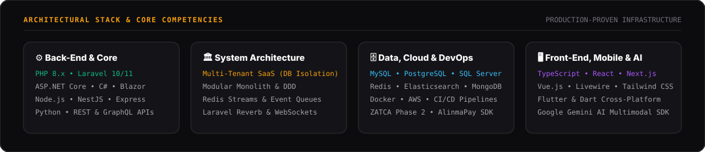

---

## 🏛️ 01 // Flagship Enterprise Systems & SaaS Platforms

<table>
  <tr>
    <td width="50%" valign="top">
      <h3>🏢 Evix Cloud ERP — Multi-Tenant Accounting & POS</h3>
      <a href="https://evix.sa">
        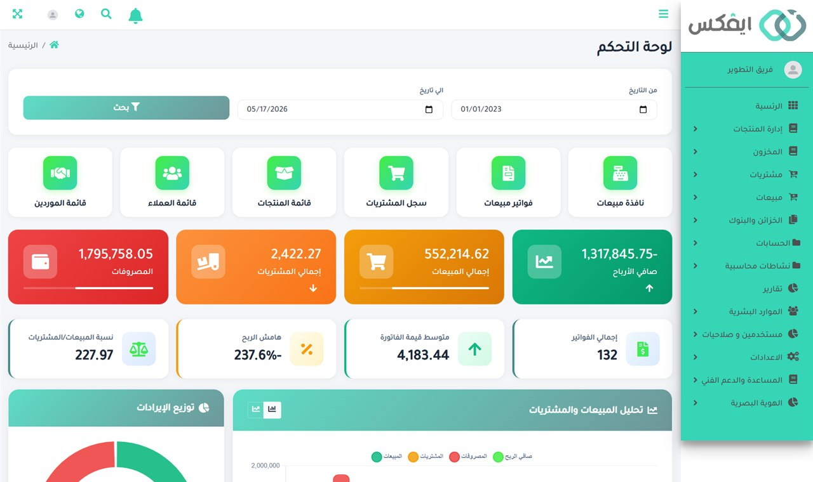
      </a>
      

        <strong>Role:</strong> Lead Back-End & Systems Architect • <a href="https://evix.sa"><strong>evix.sa ↗</strong></a> 
        Multi-tenant Cloud ERP & POS platform serving <strong>500+ enterprise organizations</strong> across Saudi Arabia with isolated tenant databases, double-entry accounting, inventory, HR/payroll, fleet management, and ZATCA Phase-2 e-invoicing.
      

      
<code>Laravel</code> <code>ASP.NET Core</code> <code>Multi-Tenancy</code> <code>MySQL</code> <code>Redis</code> <code>Docker</code>

    </td>
    <td width="50%" valign="top">
      <h3>🛰️ Evix Control Plane & Real-Time Logistics Core</h3>
      <a href="https://evix.sa">
        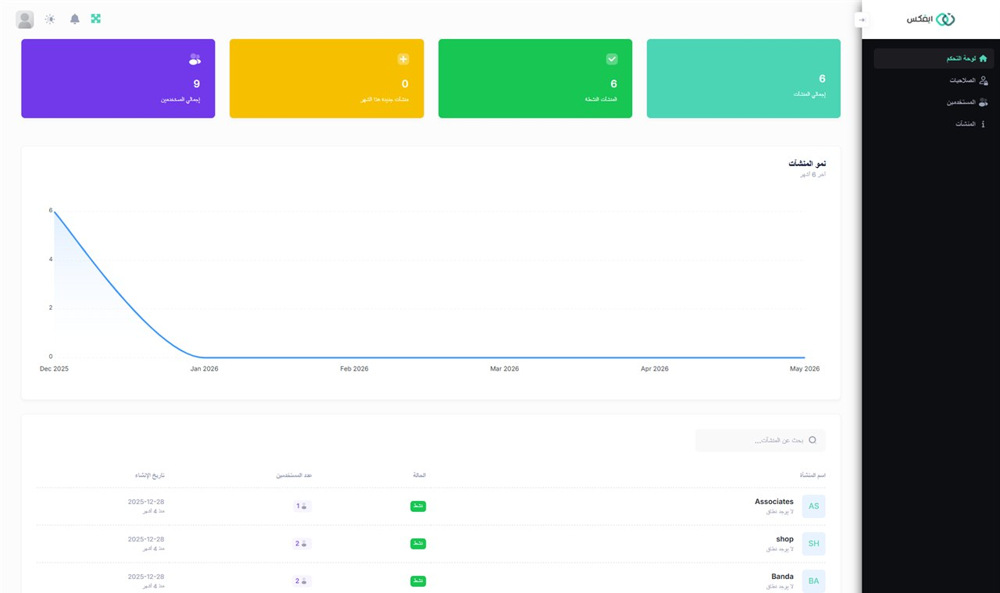
      </a>
      

        <strong>Role:</strong> Principal Back-End Engineer • <a href="https://evix.sa"><strong>Live System ↗</strong></a> 
        Centralized SaaS tenant provisioning & governance control plane paired with a high-concurrency logistics engine tracking <strong>7,000+ active delivery agents</strong> in real time via WebSockets and Redis Streams.
      

      
<code>Node.js</code> <code>Laravel Reverb</code> <code>WebSockets</code> <code>Redis Queues</code> <code>AWS</code>

    </td>
  </tr>
  <tr>
    <td width="50%" valign="top">
      <h3>🤖 LeadGen AI — B2B Intelligence & Outreach Engine</h3>
      <a href="https://github.com/dhiaamostafa46/LeadGenAI">
        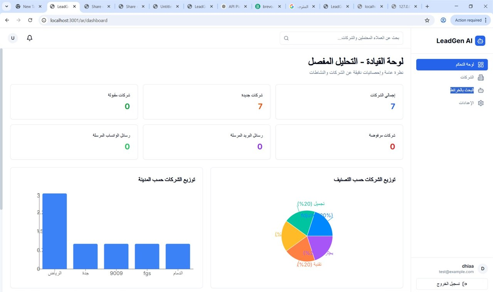
      </a>
      

        <strong>Role:</strong> Creator & Lead Engineer • <a href="https://github.com/dhiaamostafa46/LeadGenAI"><strong>GitHub Repo ↗</strong></a> 
        AI-powered B2B lead discovery, map-based company prospecting across Saudi cities (Riyadh, Jeddah, Dammam), sector classification, and automated WhatsApp/Email outreach pipelines.
      

      
<code>TypeScript</code> <code>React</code> <code>Google Gemini AI</code> <code>Node.js</code> <code>REST API</code>

    </td>
    <td width="50%" valign="top">
      <h3>🛡️ EyeinTec — Smart Security, Solar Cameras & IoT</h3>
      <a href="https://eyeintec.com">
        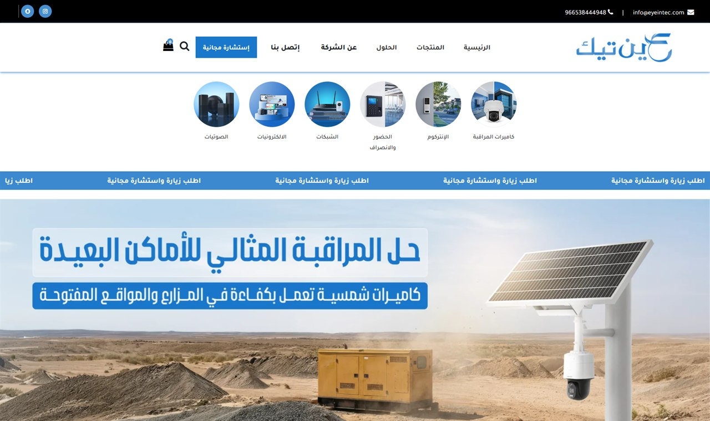
      </a>
      

        <strong>Role:</strong> Senior Software Engineer • <a href="https://eyeintec.com"><strong>eyeintec.com ↗</strong></a> 
        Digital platform and e-commerce ecosystem for remote solar-powered surveillance cameras, enterprise networking, biometric attendance systems, and smart intercoms in Saudi Arabia.
      

      
<code>Laravel</code> <code>PHP</code> <code>MySQL</code> <code>IoT Integrations</code> <code>Payment Gateways</code>

    </td>
  </tr>
</table>

---

## 🌐 02 // Commercial, Governmental & E-Commerce Platforms

<table>
  <tr>
    <td width="33.3%" valign="top">
      <a href="https://musanid.sa">
        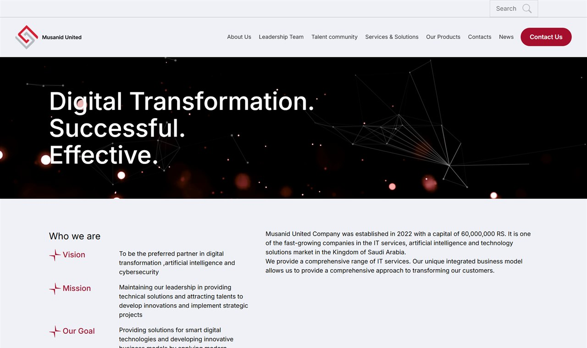
      </a>
      <h4><a href="https://musanid.sa">Musanid United (شركة مساند المتحدة) ↗</a></h4>
      
Digital transformation, AI & cybersecurity corporate platform in KSA.

    </td>
    <td width="33.3%" valign="top">
      <a href="https://eyein.sa">
        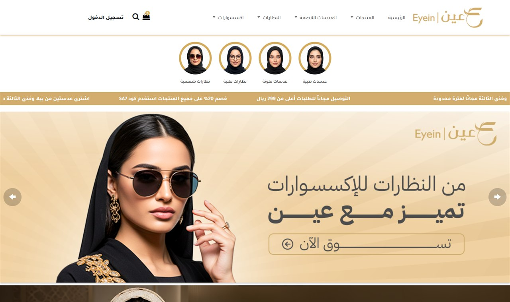
      </a>
      <h4><a href="https://eyein.sa">Eyein Optical Store (متجر عين للبصريات) ↗</a></h4>
      
Full-scale eyewear & contact lenses e-commerce platform (<a href="https://lenses.eyein.sa">lenses.eyein.sa</a>).

    </td>
    <td width="33.3%" valign="top">
      <a href="https://watantumuh.org.sa">
        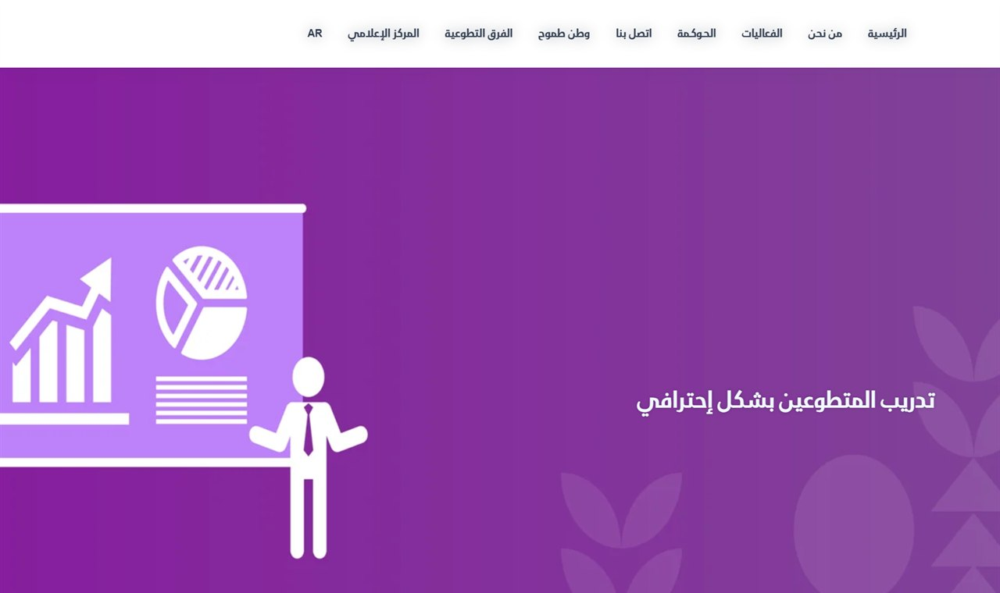
      </a>
      <h4><a href="https://watantumuh.org.sa">Watan Tumuh (وطن طموح) ↗</a></h4>
      
Institutional volunteer training, governance & initiatives portal in KSA.

    </td>
  </tr>
  <tr>
    <td width="33.3%" valign="top">
      <a href="https://miranedu.com">
        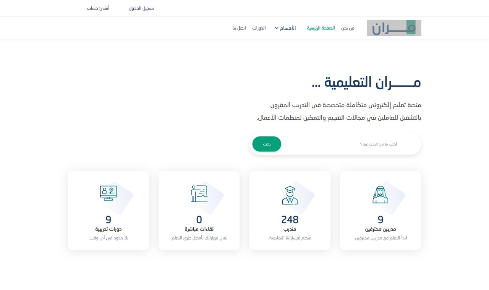
      </a>
      <h4><a href="https://miranedu.com">MiranEdu (منصة مران التعليمية) ↗</a></h4>
      
Employment-linked e-learning LMS, live training & professional assessment platform.

    </td>
    <td width="33.3%" valign="top">
      <a href="https://actesgroup.com">
        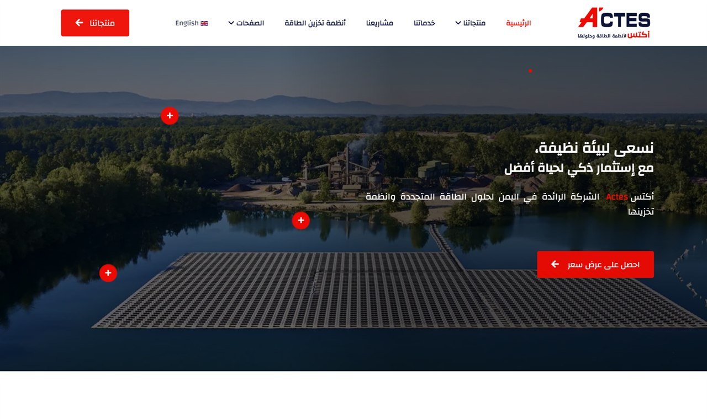
      </a>
      <h4><a href="https://actesgroup.com">Actes Energy (أكتس لأنظمة الطاقة) ↗</a></h4>
      
Renewable solar energy & power storage solutions portal.

    </td>
    <td width="33.3%" valign="top">
      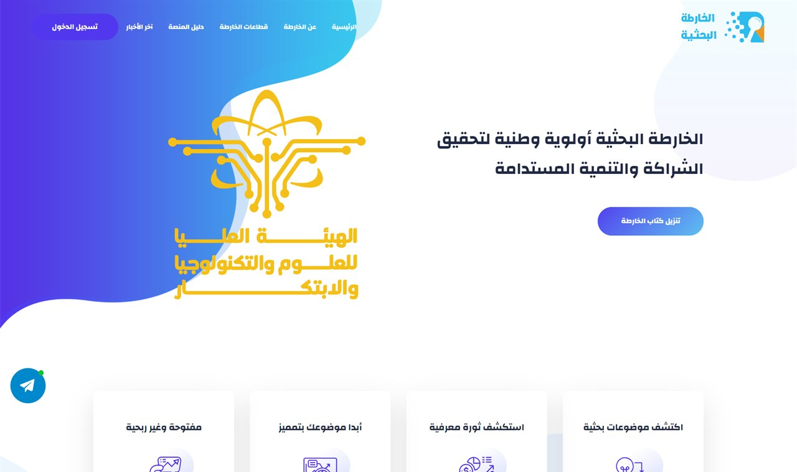
      <h4>National Research Map (الخارطة البحثية)</h4>
      
Governmental scientific research priorities & innovation portal (HASTI).

    </td>
  </tr>
  <tr>
    <td width="33.3%" valign="top">
      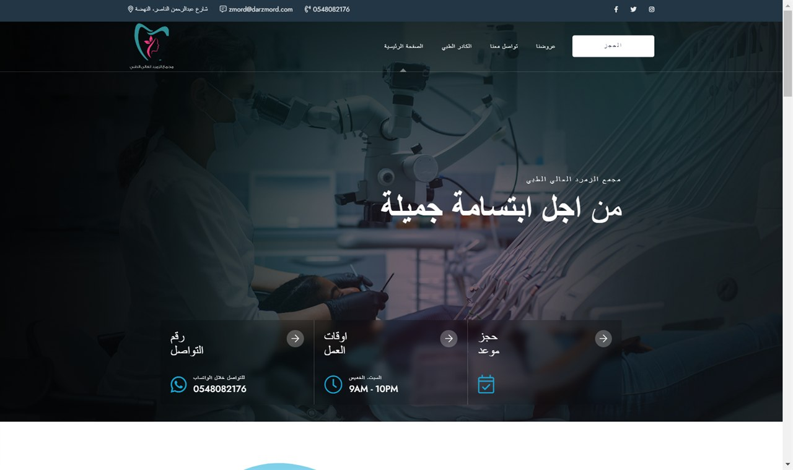
      <h4>Dar Al-Zomorod Medical (مجمع الزمرد الطبي)</h4>
      
Healthcare & dental clinics portal with online appointment scheduling.

    </td>
    <td width="33.3%" valign="top">
      <a href="https://barmgely.com">
        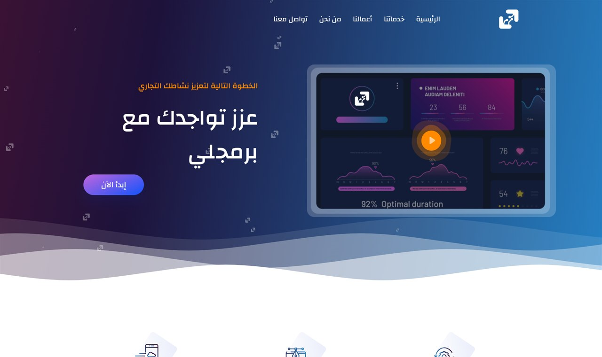
      </a>
      <h4><a href="https://barmgely.com">Barmgely & EyeinCode (عين كود / برمجلي) ↗</a></h4>
      
Software engineering, e-commerce development & digital transformation platforms.

    </td>
    <td width="33.3%" valign="top">
      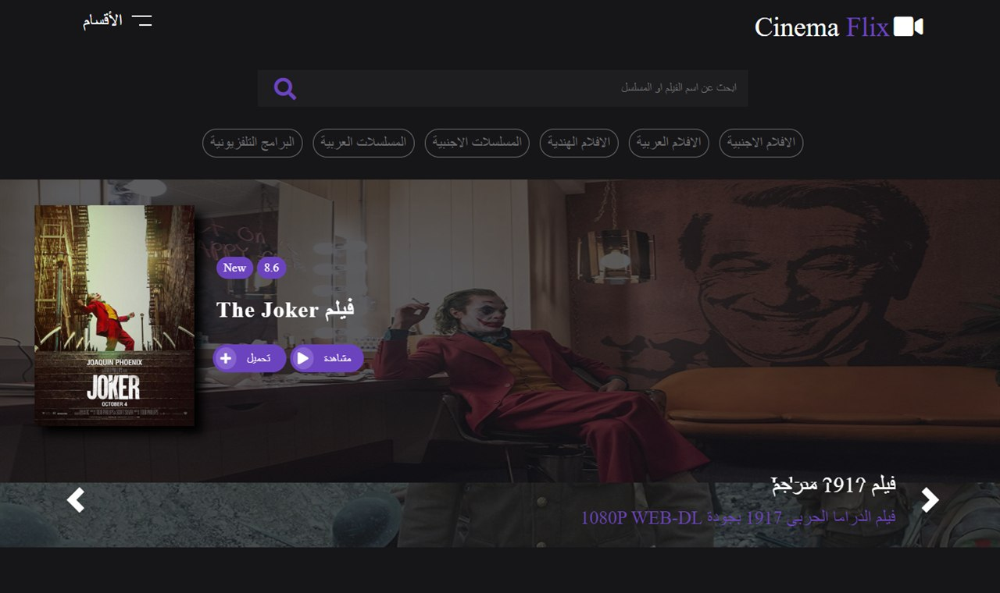
      <h4>Cinema Flix Media Platform</h4>
      
Interactive movie streaming catalog & cinema ticket booking application.

    </td>
  </tr>
</table>

---

## 📦 03 // Verified Open-Source Packages & GitHub Repositories

Direct links to my core open-source SDKs, FinTech gateways, and enterprise repositories:

| Package / Repository | Domain & Architectural Scope | Tech Stack | Repository |
| :--- | :--- | :--- | :---: |
| **`laravel-gemini`** | Multimodal Google Gemini AI SDK for Laravel (Text, Vision, Audio, Video, Structured Outputs, Function Calling & Context Caching). | `PHP` `Laravel` `Gemini AI` | [**Repo ↗**](https://github.com/dhiaamostafa46/laravel-gemini) |
| **`LeadGenAI`** | Autonomous B2B lead discovery, geospatial search & WhatsApp/Email outreach analytics platform. | `TypeScript` `React` `AI` | [**Repo ↗**](https://github.com/dhiaamostafa46/LeadGenAI) |
| **`alinma-pay`** | Enterprise banking & payment gateway integration for Alinma Bank with cryptographic signing & webhooks. | `PHP` `Laravel` `FinTech` | [**Repo ↗**](https://github.com/dhiaamostafa46/alinma-pay) |
| **`authentica`** | Zero-trust identity verification & Multi-Factor Authentication (MFA) package for enterprise systems. | `PHP` `Laravel` `Security` | [**Repo ↗**](https://github.com/dhiaamostafa46/authentica) |
| **`AetherWallet`** | Digital wallet core supporting double-entry ledger transactions, balance isolation & audit trails. | `PHP` `FinTech` `Ledger` | [**Repo ↗**](https://github.com/dhiaamostafa46/AetherWallet) |
| **`HRblazor`** | Enterprise Human Resources, Attendance & Automated Payroll platform built with C# and .NET Blazor. | `C#` `.NET` `Blazor` | [**Repo ↗**](https://github.com/dhiaamostafa46/HRblazor) |
| **`reverb`** | High-concurrency WebSocket server implementation for real-time Laravel broadcasting & live telemetry. | `PHP` `WebSockets` `Async` | [**Repo ↗**](https://github.com/dhiaamostafa46/reverb) |
| **`laravel-modules`** | Domain-Driven Design (DDD) modular monolith manager for structuring large-scale Laravel applications. | `PHP` `DDD` `Architecture` | [**Repo ↗**](https://github.com/dhiaamostafa46/laravel-modules) |
| **`ai-cv-optimizer`** | LLM-powered resume analyzer and ATS optimization engine for engineering roles. | `JavaScript` `AI` `NLP` | [**Repo ↗**](https://github.com/dhiaamostafa46/ai-cv-optimizer) |
| **`Real-estate`** | Property management, leasing & real-estate brokerage platform built on C# / ASP.NET Core. | `C#` `ASP.NET Core` | [**Repo ↗**](https://github.com/dhiaamostafa46/Real-estate) |

  
<strong>📂 Click to expand 10+ additional Laravel packages & front-end repositories</strong>

   

  - [**`laravel-datatables`**](https://github.com/dhiaamostafa46/laravel-datatables) — High-performance server-side DataTables engine for Laravel.
  - [**`laravel-notification-log`**](https://github.com/dhiaamostafa46/laravel-notification-log) — Audit logging and delivery telemetry for multi-channel notifications.
  - [**`livewire-filepond`**](https://github.com/dhiaamostafa46/livewire-filepond) — Async chunked file uploads integrating FilePond with Laravel Livewire.
  - [**`laravel-debugbar`**](https://github.com/dhiaamostafa46/laravel-debugbar) — Deep SQL query profiler and memory inspector for Laravel.
  - [**`browser-detect`**](https://github.com/dhiaamostafa46/browser-detect) — Device, OS & user-agent fingerprinting library for security auditing.
  - [**`botman`**](https://github.com/dhiaamostafa46/botman) — Multi-driver conversational chatbot automation framework in PHP.
  - [**`ReactAdmin`**](https://github.com/dhiaamostafa46/ReactAdmin) — Type-safe enterprise admin dashboard in TypeScript & React.
  - [**`vueDashboard`**](https://github.com/dhiaamostafa46/vueDashboard) — Interactive executive telemetry dashboard in Vue.js.
  - [**`Article`**](https://github.com/dhiaamostafa46/Article) — Full-stack editorial & content management application in TypeScript.
  - [**`front-end-web-ecommerce`**](https://github.com/dhiaamostafa46/front-end-web-ecommerce) — Responsive e-commerce storefront & cart experience.

---

## 💼 04 // Executive Career Timeline & Contact

- **Senior Software Engineer & ERP Architect** — **Eyein Technology / Bander Trading Co.** *(2023 – Present | Riyadh, Saudi Arabia 🇸🇦)*
  - Architected **Evix Cloud ERP** (serving **500+ enterprise clients**) and real-time logistics infrastructure (**7,000+ active delivery agents**).
- **Full-Stack Software Engineer** — **SMART SYSTEM (شركة ذكاء الأنظمة)** *(2022 – 2023 | Saudi Arabia 🇸🇦)*
  - Delivered hospitality, enterprise ERP, and security platforms with a **95%+ on-time Agile delivery rate**.
- **Full-Stack Software Engineer** — **ESKYSOFT** *(2020 – 2022 | Yemen 🇾🇪)*
  - Engineered e-learning LMS platforms, medical clinic portals, and e-commerce systems with **99.9% uptime**.

   
  <a href="https://dhiaamostafa.com"><strong>🌐 dhiaamostafa.com</strong></a> &nbsp;•&nbsp;
  <a href="https://dhiaamostafa46.github.io/dhiaamostafa46/"><strong>⚡ Interactive Dossier</strong></a> &nbsp;•&nbsp;
  <a href="https://www.linkedin.com/in/dhiaamostafa/"><strong>💼 LinkedIn</strong></a> &nbsp;•&nbsp;
  <a href="mailto:dhiaamostafa46@gmail.com"><strong>✉️ dhiaamostafa46@gmail.com</strong></a>

